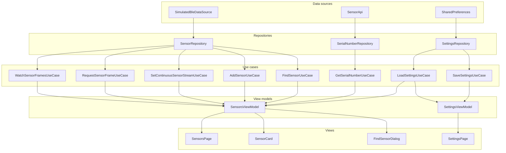

# TireSense

TireSense monitors tire pressure and temperature from a small set of sensors. Sensor frames come from a simulated BLE source. Serial numbers come from a mock HTTP API. Settings are stored on the device.

The app is in English and Portuguese. The system language decides which one is shown.

## Run

```bash
flutter pub get
flutter run
```

On the dashboard, **Simulate Sensor Update** requests one frame. With continuous stream enabled in Settings, the same button starts and stops a live stream. Temperature can be shown in °C or °F. New sensors are discovered from the add button.

## Architecture

Each layer only talks to the one below it. Views call view models, view models call use cases, use cases call repository interfaces, and the repository implementations talk to the data sources. The graph is wired in `lib/app`.

The arrow points from the provider of the data to whoever uses it.



## Tests

```bash
flutter test
flutter test integration_test
```

`flutter test` runs the unit and widget tests. The integration test boots `main`, checks the dashboard, switches the temperature unit to °F, and checks that the same card shows the converted value.
