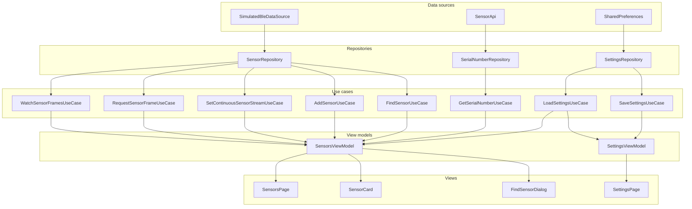

# TireSense

TireSense monitors tire pressure and temperature from a small set of sensors. Sensor frames come from a simulated BLE source. Serial numbers come from a mock HTTP API. Settings are stored on the device.

The app is in English and Portuguese. The system language decides which one is shown.

## Run

```bash
flutter pub get
flutter run
```

On the dashboard, **Simulate Sensor Update** requests one frame. With continuous stream enabled in Settings, the same button starts and stops a live stream. Temperature can be shown in °C or °F. New sensors are discovered from the add button.

## Architecture

Each layer only talks to the one below it. Views call view models, view models call use cases, use cases call repository interfaces, and the repository implementations talk to the data sources.

The arrow points from the provider of the data to whoever uses it.



State is held in Riverpod. `sensorsViewModelProvider` owns the `SensorPageState`: the sensor map, whether a stream is running, the action button, and the temperature unit. The page selects only `sensorIds`, so it rebuilds when that set of ids changes. Each `SensorCard` watches `sensorProvider(id)`, a family provider that selects that one sensor. A serial-number result replaces only that sensor's state, so only that card rebuilds. A new frame builds a new state for every known sensor, so every card on screen rebuilds. The page list does not, because the same id list is kept when no id was added. The temperature unit is a separate `select` on the same state, so changing °C to °F rebuilds the cards without treating it as a new sensor frame.

`SettingsViewModel` is watched by `SettingsPage`. Returning from that page calls `updateState()` on the sensors view model, which reloads the saved settings.

## Project layout

```text
app
├── sensors_providers
└── network_providers
core
├── usecase
├── result
└── network
shared
├── layout
├── theme
└── widgets
features
├── sensors
│   ├── data
│   │   ├── datasources
│   │   │   ├── ble
│   │   │   └── sensor
│   │   ├── dto
│   │   └── repositories (implementation)
│   ├── domain
│   │   ├── models
│   │   ├── repositories (interface)
│   │   ├── usecases
│   │   └── exceptions
│   └── presentation
│       ├── views
│       ├── view_models
│       ├── states
│       ├── widgets
│       └── helpers
└── settings
    ├── data
    │   └── repositories (implementation)
    ├── domain
    │   ├── models
    │   ├── repositories (interface)
    │   └── usecases
    └── presentation
        ├── views
        ├── view_models
        └── helpers
```

## Assumptions

- Readings arrive as frames. A frame may omit a sensor that was present before. The missing sensor stays on screen and is marked stale.
- The domain temperature is always Celsius. Fahrenheit is applied when the card formats the value.
- A serial number is requested when the sensor first appears and again after a failure. A successful serial number is not requested again.
- The simulated BLE source starts with `SENSOR_001` through `SENSOR_004`.
- The mock serial-number API knows `SENSOR_001` through `SENSOR_010`. Any other id is a 404.
- About one in five serial-number requests fails with a 503, so the error and retry states are visible without a real network.
- The device language selects English or Portuguese. The English label of the update button is exactly "Simulate Sensor Update".

## Limitations

- There is no physical BLE device and no real server. `SimulatedBleDataSource` stands in for BLE behind `SensorRepositoryImpl`. `MockHttpClient` stands in for HTTP behind `SensorApiImpl`. `SerialNumberRepositoryImpl` calls the `SensorApi` interface, not the mock.

## Possible improvements

- Add a way to remove a sensor. The list only grows. A remove action would drop that id from the simulated source and from the page state.
- Replace the `MaterialApp` route table with `go_router` if a route needs an id, a redirect, or the find-sensor dialog becomes a page. Settings is already the named route `/settings`.
- Add a small log of frames, serial-number failures and setting changes. Today those events only update the screen, so a failed request is visible on the card and nowhere else.
- Add feature flags so extras such as the continuous stream, adding sensors, and Fahrenheit can be turned on or off without shipping a new build.
  
## Tests

```bash
flutter test
flutter test integration_test
```

`flutter test` runs the unit and widget tests. The integration test boots `main`, checks the dashboard, switches the temperature unit to °F, and checks that the same card shows the converted value.
