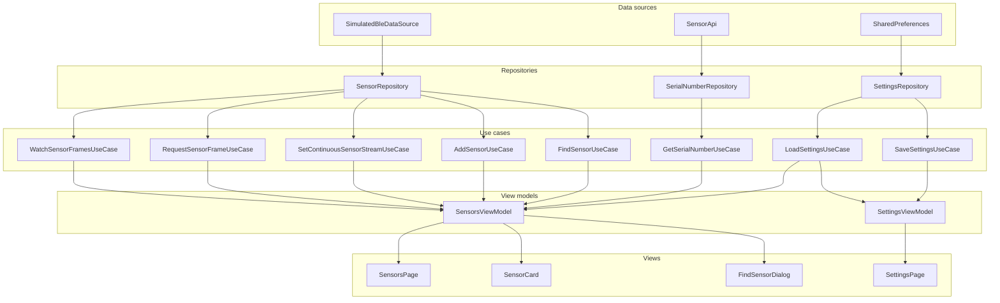

# TireSense

TireSense monitors tire pressure and temperature from a small set of sensors. Sensor frames come from a simulated BLE source. Serial numbers come from a mock HTTP API. Settings are stored on the device.

The app is in English and Portuguese. The system language decides which one is shown.

## Run

```bash
flutter pub get
flutter run
```

On the dashboard, **Simulate Sensor Update** requests one frame. With continuous stream enabled in Settings, the same button starts and stops a live stream. Temperature can be shown in °C or °F. New sensors are discovered from the add button, up to the limit enforced by `AddSensorUseCase`.

## Architecture

Each layer only talks to the one below it. Views call view models, view models call use cases, use cases call repository interfaces, and the repository implementations talk to the data sources. The graph is wired in `lib/app`.

The arrow points from the provider of the data to whoever uses it.



`SensorsViewModel` reads the saved settings through `LoadSettingsUseCase`, including the temperature unit shown on each card. It does not watch `SettingsViewModel`.

State is held in Riverpod. `sensorsViewModelProvider` owns the page: the sensor map, whether a stream is running, the button action, and the temperature unit. The page selects only `sensorIds`, so it rebuilds when a sensor is added or removed. Each `SensorCard` watches `sensorProvider(id)`, a family provider that selects that one sensor. A new serial number or a new reading rebuilds that card. The other cards stay as they are. The temperature unit is a separate `select` on the same state, so changing °C to °F rebuilds the cards without treating it as a new sensor frame.

`SettingsViewModel` is watched only by `SettingsPage`. Returning from that page calls `updateState()` on the sensors view model, which reloads the saved settings.

## Assumptions

- Readings arrive as frames. A frame may omit a sensor that was present before. The missing sensor stays on screen and is marked stale.
- The domain temperature is always Celsius. Fahrenheit is applied when the card formats the value.
- A serial number is requested when the sensor first appears and again after a failure. A successful serial number is not requested again.
- The simulated BLE source starts with `SENSOR_001` through `SENSOR_004`.
- The mock serial-number API knows `SENSOR_001` through `SENSOR_010`. Any other id is a 404.
- About one in five serial-number requests fails with a 503, so the error and retry states are visible without a real network.
- Adding a sensor is capped at 7. The cap is a use case rule. The repository only stores the sensor.
- The device language selects English or Portuguese. The English label of the update button is exactly "Simulate Sensor Update".

## Limitations

- There is no physical BLE device and no real server. Both boundaries are mocks behind the repository interfaces.
- The continuous stream and the add-sensor flow are extras. With the stream setting off, the button always requests a single frame.
- The card shows the temperature unit loaded when the screen opens and when you return from Settings. It does not watch `SettingsViewModel`.
- Discovery waits about two seconds and can return an id that the next frame occasionally omits, so a newly added sensor can appear stale until the next update.

## Possible improvements

- Replace `SimulatedBleDataSource` and `MockHttpClient` with a real BLE client and HTTP client without changing the use cases.
- Page the sensor list if the count grows far past what a phone can show at once. The list is already built from ids, and each card already observes only itself.
- Keep the English button label in every locale if a review must see the exact string "Simulate Sensor Update".

## Tests

```bash
flutter test
flutter test integration_test
```

`flutter test` runs the unit and widget tests. The integration test boots `main`, checks the dashboard, switches the temperature unit to °F, and checks that the same card shows the converted value.
